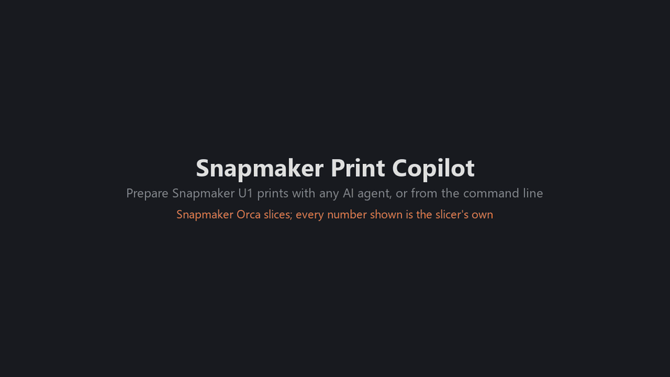
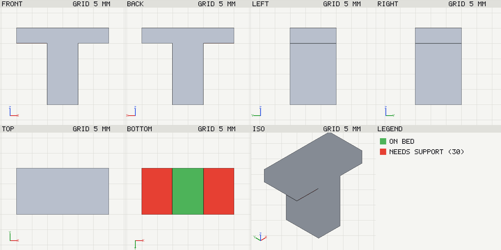
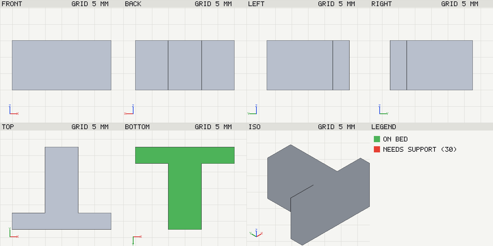

# Snapmaker Print Copilot

An MCP server and command line that prepare prints for the **Snapmaker U1**
toolchanger, using **Snapmaker Orca** as the slicing engine. It slices the
alternatives that matter (orientations, supports, prime tower and tool-change
strategies, settings) and shows what the slicer measured for each, puts the
plate's colours on the spools the U1's RFID readers report, writes the chosen
setup as a project that opens in Snapmaker Orca, and starts the print only
after you confirm. An AI agent (Claude Code, Codex, Claude Desktop or any other
MCP client) drives it through 24 MCP tools; every tool is also a
`print-copilot` command.



A recorded command-line session (51 s, also as [MP4](docs/images/demo.mp4)).
Every frame shows real output; the printer in the last step is the bundled
simulator (`print-copilot printer fake`). Upload, start and RFID head mapping
were also checked on a real U1, see [verified facts](docs/verified-facts.md).
The demo is rebuilt with `research/demo/`.

## What a session looks like

An example conversation. The numbers are from a real slice of
`tests/fixtures/tee.stl` with the U1's 0.16 mm Standard process and Snapmaker
PLA SnapSpeed:

```text
You:    Print tee.stl in black. Which way up?
Agent:  T1 has the black PLA. I sliced the best orientations:
          as loaded, tree supports     18m 02s   3.99 g   (1.00 g of it support)
          lying on its side (-Y down)   9m 16s   3.03 g   no support needed
        Lying on its side is faster and needs no support. Write the project?
You:    Yes.
Agent:  Saved tee-u1.3mf and tee-u1.gcode and opened the project in Snapmaker
        Orca. Uploaded the G-code to the U1; here is the start plan (file,
        request, per-head checks). Start it?
You:    Start.
```

| As loaded: red faces need support | Lying on its side: nothing to support |
| --- | --- |
|  |  |

The agent looks at renders like these to decide which way up a part prints
and which surfaces must stay clean.

## What it knows about the U1

Beyond a generic slicer wrapper:

- **Four heads, real spools.** The filaments a plate uses are put on the head
  whose loaded colour is closest, read from the U1's RFID readers (or from the
  app's selection); a one-colour print always asks which head to use.
- **What a project really prints.** Settings a 3MF stores on objects and parts
  (MakerWorld projects set infill and supports there) and settings saved for
  another printer are reported before slicing, because the G-code header does
  not show them.
- **Measured, not guessed.** Times and grams are the slicer's own; tool
  changes, prime tower, purge and support material are measured from the
  G-code toolpaths. Geometric scores are labelled as heuristics.
- **Settings from the model.** Thin features, tall parts on a small base,
  surfaces where layer steps show and the print's purpose decide which few
  settings are worth slicing as variants.
- **Nothing physical without consent.** Starting a print goes through a plan
  that shows the exact request and per-head checks; cancel and heaters-off
  are never gated.
- **Snapmaker Orca CLI workarounds** found by testing, so headless slicing of
  U1 projects works (see [How slicing works](docs/usage.md#how-slicing-works)).

Status: working end to end on Windows with Snapmaker Orca 2.4.1. Two real
prints on a U1 went through upload, start and RFID head mapping; what was and
was not verified on hardware is listed in
[docs/verified-facts.md](docs/verified-facts.md). Cancel and heaters-off have
not been sent to a printer yet.

## Install

Windows only for now.

**1. Prerequisites** (once):
[Snapmaker Orca](https://www.snapmaker.com/snapmaker-orca), opened at least
once, and [uv](https://docs.astral.sh/uv/getting-started/installation/), which
installs Print Copilot and the Python it needs. To install uv, paste this into
PowerShell:

```powershell
powershell -ExecutionPolicy ByPass -c "irm https://astral.sh/uv/install.ps1 | iex"
```

**2. Install Print Copilot.** Open a new PowerShell window and paste:

```powershell
uv tool install https://github.com/antonio94770/Snapmaker-U1-Print-Copilot/archive/refs/heads/main.zip
print-copilot setup
```

`setup` should print your printer, process and filaments as selected in
Snapmaker Orca. If it does, everything is installed. If PowerShell says
`print-copilot` is not recognized, run `uv tool update-shell` and open a new
window.

**3. Connect your AI agent:**

| Agent | Command |
| --- | --- |
| Claude Code | `print-copilot connect claude-code` |
| Codex | `print-copilot connect codex` |
| Claude Desktop | `print-copilot connect claude-desktop` |
| VS Code (GitHub Copilot) | `print-copilot connect vscode` |
| Cursor | `print-copilot connect cursor` |
| Gemini CLI | `print-copilot connect gemini` |

It adds the server to that agent's settings with the right path, keeps the
other servers and a `.bak` copy of the file, and says what it changed
(`--dry-run` only shows it). Restart the agent and ask: *"What printer and
filaments do I have selected in Snapmaker Orca?"*

**Update** with
`uv tool install --reinstall https://github.com/antonio94770/Snapmaker-U1-Print-Copilot/archive/refs/heads/main.zip`;
**remove** with `uv tool uninstall snapmaker-print-copilot`.

<details>
<summary>Problems, other agents, install from source</summary>

- Gemini CLI turns MCP servers off in folders you have not trusted: accept
  its trust prompt.
- Large models can take minutes to slice: `connect` sets a 10-minute tool
  timeout for Codex and Gemini CLI; for Claude Code start it with
  `MCP_TOOL_TIMEOUT=600000`.
- Another MCP client: add a stdio server whose command is the full path of
  `print-copilot-mcp.exe`, with no arguments (`print-copilot connect cursor
  --dry-run` prints that path). [docs/mcp-setup.md](docs/mcp-setup.md) shows
  the settings for each agent by hand, the environment variables and the full
  tool list.
- From source, for development (needs [Git](https://git-scm.com/download/win)
  and [Python](https://www.python.org/downloads/windows/) 3.11 or newer):

  ```powershell
  git clone https://github.com/antonio94770/Snapmaker-U1-Print-Copilot.git
  cd Snapmaker-U1-Print-Copilot
  py -m venv .venv
  .venv\Scripts\python -m pip install -e ".[dev]"
  .venv\Scripts\print-copilot setup
  ```

  Commands then run as `.venv\Scripts\print-copilot`, and `connect` points
  the agent at this folder. If `git clone` reports "Filename too long", clone
  into a shorter folder or run `git config --global core.longpaths true`
  first.

</details>

## How the agent works

With the MCP server connected, the agent follows the order the server
describes:

1. Reads what is selected in Snapmaker Orca and what the U1 reports
   (`get_current_setup`, `printer_status`).
2. Inspects the project (`inspect_project`): plates, size and fit, filaments
   and proposed heads, object settings and differences from the process. It
   tells the user before slicing and asks which values to keep.
3. Optionally compares orientations and supports (`optimize_orientation`),
   tool-change strategies (`compare_strategies`) and the settings the model's
   shape bears on (`suggest_settings`).
4. Reviews the effective settings and the toolpaths (`review_print`,
   `preview_gcode`).
5. Writes the chosen setup as a new 3MF, slices that same file and opens it
   in Snapmaker Orca (`export_project`).
6. Uploads the G-code, shows the start plan and starts only after the user
   says so (`upload_to_printer`, `plan_print_start`, `start_print`).

## Without an AI agent

Every MCP tool has a `print-copilot` command, so nothing here needs an AI
subscription. A few to start with:

```powershell
print-copilot orient model.stl --top 3 --support none --support tree
print-copilot project downloaded.3mf
print-copilot export-project downloaded.3mf --plate 1 --out my-print.3mf --open
print-copilot printer status
print-copilot printer start my-print.gcode --dry-run
```

`orient` slices the best orientations with and without supports; `project`
lists plates, filaments and the heads they would go on; `export-project`
writes and slices a project for Snapmaker Orca; `printer start` shows the
plan and sends only after you type `start`.

## Documentation

- [Command line reference](docs/usage.md): presets, slicing and variants,
  multi-colour projects, quality review, printer, how slicing works.
- [MCP setup by hand](docs/mcp-setup.md): settings for each agent,
  environment variables, tool list.
- [Quality review](docs/quality-review.md): the checks, their limits and the
  review procedure.
- [Verified facts](docs/verified-facts.md): what was checked in Snapmaker
  Orca and on the U1, and how.

## Development

```bash
ruff check . && ruff format --check .
pytest
```

The integration tests slice a 20 mm cube, a T-shaped part and a synthetic
multi-colour project, and are skipped when Snapmaker Orca is not installed.
Tests on real downloaded projects run when `PRINT_COPILOT_TEST_PROJECTS`
points to a folder filled by `python research/m4-probe/download_projects.py <folder>`
(the files are not in the repository; their licences vary).

## Related projects

This project is original work: it does not fork or include another project's
code. It runs Snapmaker Orca (AGPL-3.0, based on OrcaSlicer) as an external
program and talks to the U1 through Moonraker's HTTP API. Projects that cover
part of the same ground:

- Generic OrcaSlicer MCP servers: `orcaslicer-mcp` by MaxEllis (needs a
  patched OrcaSlicer build with a local API), `orca-mcp` (wraps the
  OrcaSlicer CLI, parameter sweeps), `claude-orcaslicer-mcp` by
  ShreddyKrueger75 (slicing and sending to a printer) and
  `itsumonotakumi/orcaslicer-mcp`.
- `mcp-3d-printer-server` by DMontgomery40: printer control over MCP, with a
  Moonraker backend.
- `MoraesGil/snapmaker-orca-mcp`: slices a saved 3MF plate with the Snapmaker
  Orca engine on macOS.
- `josuanbn/bl2u1`: converts Bambu Studio projects into Snapmaker Orca U1
  projects; Any2orca does the same for MakerWorld projects.
- [Snap Studio](https://github.com/kameka22/snap-studio) by kameka22: a
  desktop app for the U1 with the Snapmaker Orca engine, Claude-based model
  editing, RFID head mapping and a print queue. Print Copilot is not an app:
  it gives any MCP agent, or a script, measured comparisons and a quality
  review, and hands the result to Snapmaker Orca as a project.

What this project adds for the U1: head assignment from the loaded RFID
spools, measured tool changes, prime tower and supports, strategy and
settings comparisons, a quality review of the effective settings and
toolpaths, projects exported for Snapmaker Orca from the same file that is
sliced, and a gated print start, all usable without AI from the CLI.

## License

GPL-3.0-or-later (see [LICENSE](LICENSE)). Snapmaker Orca is AGPL-3.0 and is
only invoked as an external program.
