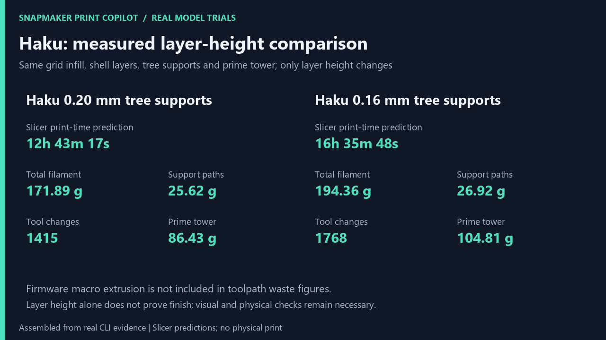

# Complex model trials

Recorded on 2026-10-29 with the installed Snapmaker Orca 2.4.1, U1 0.4 mm
nozzle, and Snapmaker PLA SnapSpeed on all four heads. The current process
was `0.16mm Standard @Snapmaker U1 (0.4 nozzle)`.

[Watch the 42-second MP4](images/complex-models.mp4) or
[view the GIF](images/complex-models.gif). This is an assembled presentation
of actual CLI results, model renders and G-code previews, not a screen
recording or a physical printing timelapse. No printer commands were sent.

## Haku Dragon Diorama

These initial layer-height trials use selected-preset speeds and some saved
project settings; they are not the restored saved-process reference. See
[the follow-up optimization comparison](optimization-results.md) for that
reference and the measured optimization candidates.

[Haku Dragon Diorama (Spirited Away), by Lynns](https://space.snapmaker.com/en/model/45404-haku-dragon-diorama-spirited-away#profileId-49095),
CC BY-NC-ND 4.0. The user downloaded the original 3MF from Snapmaker Space.

- Input SHA-256: `6cd56bc63eb17a54e6b5bb8ed32ea982809dcfee5610150597efec115fd61c6d`.
- One plate, four painted PLA filaments, 168,066 triangles.
- Bounds: 95.7 × 85.9 × 120.0 mm; fits the declared U1 bed.
- Project colours: white, navy, cream and teal, mapped explicitly to T0–T3
  for the slicing trial. The app's selected colours were white, black and
  two greys; they do not reproduce the source colour scheme. No current
  RFID reading was used and no colour-loading operation was performed.

The imported project saves 0.20 mm layers and enables supports. Simply
using the selected process would change layers to 0.16 mm and disable
supports. The trial therefore explicitly kept tree supports, a 30-degree
threshold, build-plate-only supports and the prime tower in both variants.
Both retained the project's 0.25 mm first layer, five top layers, three
bottom layers and grid infill. Only nominal layer height changed.

| Variant | Slicer time prediction | Total filament | Support paths | Tool changes | Prime tower |
| --- | ---: | ---: | ---: | ---: | ---: |
| 0.20 mm, tree supports | 12 h 43 min 17 s | 171.89 g | 25.62 g | 1,415 | 86.43 g |
| 0.16 mm, tree supports | 16 h 35 min 48 s | 194.36 g | 26.92 g | 1,768 | 104.81 g |



Time and total grams are read from the slicer's G-code. Support and tower
grams are derived from labelled toolpaths using the parser's filament
conversion. They exclude unknown extrusion inside firmware macros, including
`SM_PRINT_PREEXTRUDE_FILAMENT` (`TO VERIFY ON HARDWARE`). Lower nominal layer
height does not establish better physical surface finish.

The experiment exposed two distinct limitations:

1. **0.20 mm: quality audit blocked.** Orca's header says
   `total layer number: 599`, matching 599 `;LAYER_CHANGE` markers, while its
   final summary says `total layers count = 600`. The strict audit retained
   this disagreement as an error at the time. Later it turned out that the
   footer figure is the firmware progress counter (810 for 808 layers in a
   2026-10-30 print), so the parser now takes the header number and keeps the
   footer one only as a fallback; the audit still fails when the markers
   disagree with the header.
2. **0.16 mm: complete preview blocked.** Header, markers and summary agree
   at 749 layers, but the complete offline HTML preview exceeds its 100 MB
   guard. A separately labelled selected-layer excerpt was generated from
   the original G-code. It does not replace the failed complete review.

The 0.20 mm preview contains 1,748,951 segments; the 0.16 mm input contains
2,271,267. The explicit parser limit was raised from one to six million
segments for this trial. The independent 100 MB HTML guard remains enabled.
Bridge, overhang, support-interface, commanded-flow and calibration findings
remain visible in the retained evidence. Model and selected-layer views
were inspected; no physical finish or successful print is claimed.

## Mechanical Planetarium — Tuned

[Mechanical Planetarium — Tuned, by HackerJack42](https://www.printables.com/model/47796-mechanical-planetarium-tuned),
based on the original design by Zippitybamba; CC BY-NC-SA 4.0.

All 49 STL files in the downloaded archive were loaded and inventoried with
SHA-256 hashes and triangle counts. Four representative parts were sliced
using the selected 0.16 mm process, three walls and the user's chosen T0
white PLA. Supports were disabled; their reported zero usage is not proof
that every unsupported region will print successfully.

| Part | Slicer time prediction | Total filament | Support paths |
| --- | ---: | ---: | ---: |
| Base drive gear, herringbone | 1 h 15 min 07 s | 31.23 g | 0.00 g |
| Base housing | 3 h 03 min 40 s | 101.84 g | 0.00 g |
| Calendar gear | 1 h 58 min 00 s | 45.36 g | 0.00 g |
| Main axle | 2 h 13 min 56 s | 40.15 g | 0.00 g |

All four generated complete offline previews and reached
`visual_review_pending` without an audit error. Their audits still flag
commanded-flow and bridge inspection; the housing also flags overhang
inspection. The selected housing layers show its upper bridging region.
These are preparation results for four components, not a validation of the
complete mechanism, its tolerances or assembly. The remaining 45 STL files
were inventoried, not sliced.

## Reproduction and retained evidence

Download the models from their source pages into
`research/showcase/models/`. Place the Haku 3MF at
`Haku_Dragon_Diorama_(Spirited_Away)_SM.3mf` and extract the Printables model
archive into `planetarium/`, preserving its folders. Downloaded models and
local run outputs are ignored by Git and retain their source licenses.
Do not execute scripts from the downloaded archive.

```powershell
.venv/Scripts/python.exe research/showcase/run_showcase.py
```

The runner creates a fresh `runs/complex-showcase-TIMESTAMP/` containing
exact command arguments, raw stdout/stderr, input hashes, settings,
measurements, per-slice directories and slicer logs. A second argument can
resume that same run without repeating already recorded commands.
The original trial evidence is in `runs/complex-showcase-20261029-151944/`.

For an input whose complete preview exceeds the HTML guard:

```powershell
.venv/Scripts/python.exe research/showcase/selected_preview.py INPUT.gcode NEW_OUTPUT_DIRECTORY
```

This explicitly creates an excerpt, never an accepted quality review.
For this demo use `haku-fine-selected` inside the run directory. Rebuild the
media with a Python environment providing Pillow and an available `ffmpeg`:

```powershell
python research/showcase/make_media.py runs/complex-showcase-20261029-151944
```

Source geometry was not edited. The repository does not bundle the STL or
3MF downloads. Model imagery retains the notices in
[the media attribution file](images/complex-models-attribution.md), separate
from the repository's software license.

## Verification of these changes

Ruff lint and formatting checks passed for the repository and the research
scripts. All 66 targeted tests for mesh loading, G-code headers and features,
toolpaths, rendering and settings advice passed with a workspace-local pytest
temporary directory. The MP4 decoded without errors; both media files are
1280 × 720 and 42 seconds long.

The full pytest suite did not complete: the initial default temporary-directory
setup failed, and a retry with a workspace-local directory stalled in the MCP
tool-listing test. That retry was interrupted. The full suite is not reported
as passing; no production parser, quality gate or MCP code was changed to
make this demonstration pass.
