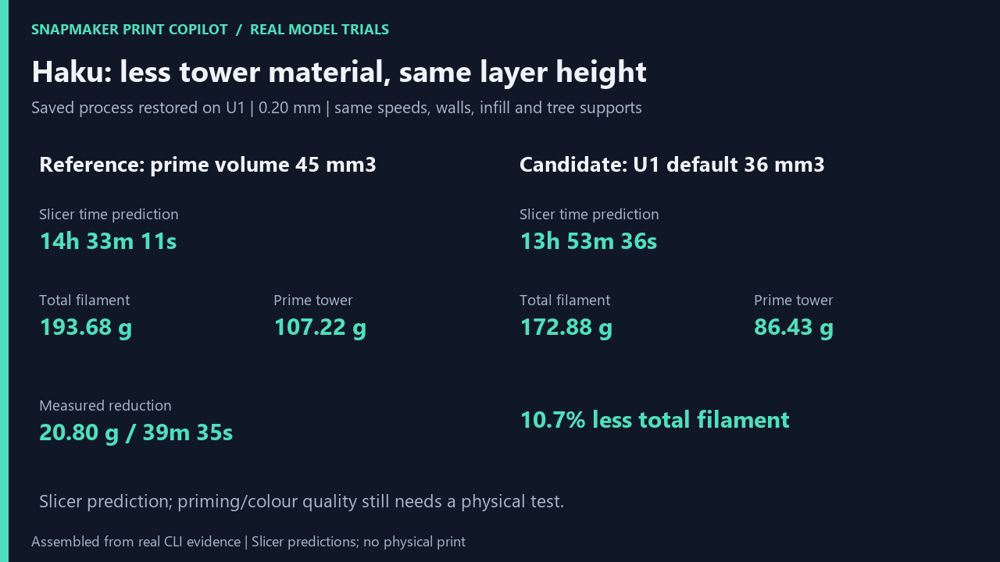

# Measured optimization candidates

The later [novice workflow trial](novice-workflow-trial.md) found an
export/import mismatch: the chosen process settings were present in a new
3MF and its paired CLI G-code, but opening/re-slicing it in Orca used preset
defaults. The measured comparisons below remain evidence for their actual
G-code files, not proof that GUI delivery preserves those settings.

On 2026-10-29, Snapmaker Print Copilot compared eight real slices with the
installed Snapmaker Orca 2.4.1 for the U1 0.4 mm nozzle. This follow-up tests
actual alternatives against a fixed reference, rather than treating a
change in layer height as an optimization.

[35-second MP4](images/optimization.mp4) · [GIF](images/optimization.gif) ·
[model sources and attribution](images/complex-models-attribution.md).
The media is assembled from actual slicer output, not a physical timelapse.
No printer commands were sent.

## Haku: reduce the tower while keeping it enabled

The saved 3MF differs from the selected 0.16 mm process in more than layer
height and supports: it also saves lower speeds, different accelerations,
support gaps and a larger prime volume. The initial
[layer-height trials](complex-model-trials.md) did not restore all these
settings and must not be used as the original-project reference.

This experiment restored all 109 saved process fields recognized by the
installed flattened preset. Unary speed lists were normalized to scalar
values where the current preset requires scalars. Preset identity/output
metadata and the existing `wipe_tower_filament` CLI workaround were excluded.
Machine and filament profiles were held constant across all variants:
U1 0.4 mm and four Snapmaker PLA SnapSpeed profiles. Source geometry, painted
assignments, layer height (0.20 mm), first layer (0.25 mm), walls, shell
layers, infill, speeds and support contacts were retained.

| Candidate | Slicer time prediction | Total filament | Prime tower | Support paths |
| --- | ---: | ---: | ---: | ---: |
| Saved process restored, prime volume 45 mm³ | 14 h 33 min 11 s | 193.68 g | 107.22 g | 25.08 g |
| Installed U1 preset prime volume, 36 mm³ | 13 h 53 min 36 s | 172.88 g | 86.43 g | 25.08 g |
| Normal supports, same threshold and 45 mm³ priming | 14 h 16 min 20 s | 207.58 g | 107.22 g | 38.98 g |
| Tower disabled, experimental | 9 h 24 min 35 s | 86.46 g | 0.00 g | 25.08 g |

**The retained candidate saves 20.80 g (10.74% of total filament) and
39 min 35 s (4.53% of predicted time).** The prime-volume value comes from
the installed U1 preset; it is not an invented purge estimate. Normal
supports increase material usage. Removing the tower saves more but leaves
priming/ooze behaviour unverified, so it is not the retained recommendation.

The effective G-code configurations of reference and retained candidate
differ **only in `prime_volume` (45 → 36)**. Both have 1,415 tool changes.
An independent path comparison found:

- All 689,314 support segments match, including endpoints, feature labels,
  assigned tools and layer numbers, with identical extrusion totals.
- All outer-wall trajectories match. Of the model paths, 863,210 segments
  match; the reference has one additional internal-solid-infill segment at
  layer 290, approximately 0.024 mm long. Geometry endpoints were compared
  after rounding to 0.00001 mm, independently of path order.
- The model extrusion-total difference is 0.00067 mm of filament. This is
  not described as bitwise identity or as a measured surface-quality result.



Both complete selected-layer/interactive previews were generated and the
selected model/support layers were inspected. Both audits still block on
the existing **599 path layers versus 600 in the slicer's final summary**.
That error was not waived. The recommendation is therefore a measured
optimization candidate for review, not an accepted physical print setup.
Filament/head calibration and the adequacy of 36 mm³ priming for these
colours require a physical test. App colours also differ from the original
white/navy/cream/teal scheme; the explicit T0–T3 assignment was used offline.

## Planetarium housing: correct its orientation

Only a rigid 180-degree rotation was applied to the housing mesh. Triangle
count and mesh volume were checked before writing a new local STL. All
comparisons keep the same 0.16 mm process, three walls, infill, material and
T0 white selection. Automatic supports use the same tree type and threshold.

| Orientation | Automatic supports | Slicer time prediction | Total filament | Support paths |
| --- | --- | ---: | ---: | ---: |
| As loaded | Off | 3 h 03 min 40 s | 101.84 g | 0.00 g |
| As loaded | On | 10 h 29 min 10 s | 160.14 g | 58.30 g |
| Flipped | Off | 3 h 01 min 11 s | 102.56 g | 0.00 g |
| Flipped | On | 3 h 00 min 59 s | 102.56 g | 0.00 g |

**With automatic supports enabled in both positions, flipping saves
57.58 g (35.96%) and 7 h 28 min 11 s (71.23%).** The supported as-loaded
reference requires trees underneath its broad roof. Flipping puts that
surface on the bed; automatic support generation then produces zero support
material without disabling the support setting.

This is not a 36% saving against the source STL sliced without supports.
Against the unsupported as-loaded reference, the unsupported flipped slice
is only 2 min 29 s faster and uses **0.72 g more**. The benefit is avoiding
the broad downward-facing surface: the geometric support heuristic drops
from 15,945.3 to about 0.6 mm², the actual G-code's overhang warning disappears,
and bridge-feature extrusion decreases from 2,607.898 to 1,764.164 mm of
filament. Internal bridges remain; zero support material is not a physical
quality guarantee. The functional housing will have a different bed-facing
surface, and adhesion, tolerances and assembly remain untested.

The flipped candidate generates a complete offline preview and reaches
`visual_review_pending`, with no audit error. Flow-demand and calibration
warnings remain. The supported as-loaded reference's complete HTML exceeds
100 MB; its separately labelled selected-layer excerpt was inspected.
The main axle's heuristic already prefers its source orientation, so no
orientation improvement is claimed for it or for the entire 49-part model.

## Review files and reproducible evidence

Experiment directories, ignored by Git:

- `runs/optimize-showcase-20261029-155026/`: restored values, four Haku
  variants, exact CLI arguments, logs, G-code configurations, complete
  candidate previews, path fingerprints and exact segment differences.
- `runs/planetarium-optimization-20261029-155121/`: four housing slices,
  rotated STL, geometry renders, audits and selected reference layers.

New exports were written into each directory's `exports/` folder:

- `haku-reference-review.3mf` and `.gcode`.
- `haku-prime36-review.3mf` and `.gcode`.
- `housing-flipped-review.3mf` and `.gcode`.

Each exported project was itself re-sliced to produce its paired G-code.
Export/re-slice results are retained separately: the Haku reference reports
193.68 g / 14 h 33 min 11 s, while its exported candidate reports
172.39 g / 13 h 50 min 38 s. The latter differs slightly from the initial
candidate slice, despite identical effective settings. The aligned source
and exported mesh have 168,066 triangles and coordinate differences below
0.000000000001 mm; the cause of this re-slicing variation was not established.
The conservative controlled-run saving above is kept separate from those
export numbers. The exported housing reports 102.56 g / 3 h 01 min 11 s.
These files are labelled for review; no quality acceptance or print-start
permission is implied by their existence.

Reproduce the searches with the repository environment and downloaded inputs
from the [initial trials](complex-model-trials.md):

```powershell
.venv/Scripts/python.exe research/showcase/optimize_showcase.py
.venv/Scripts/python.exe research/showcase/optimize_planetarium.py
.venv/Scripts/python.exe research/showcase/compare_paths.py HAKU_RUN
.venv/Scripts/python.exe research/showcase/path_differences.py HAKU_RUN
.venv/Scripts/python.exe research/showcase/export_optimized.py HAKU_RUN HOUSING_RUN
.venv/Scripts/python.exe research/showcase/export_optimized.py HAKU_RUN HOUSING_RUN baseline
```

Generate `quality-0.json` and `quality-1.json` in `HAKU_RUN` by running
`print-copilot quality GCODE --max-segments 6000000 --json` for the two
controlled Haku slices. Preserve blocked reports and their nonzero exit
status. With Pillow and ffmpeg available, rebuild the new media using:

```powershell
python research/showcase/make_optimization_media.py HAKU_RUN HOUSING_RUN
```

All times are slicer predictions. Total grams come from G-code summaries;
support/tower grams are derived from explicit labelled extrusion paths.
Extrusion hidden in firmware macros is excluded (`TO VERIFY ON HARDWARE`).
No model download or generated 3MF is distributed as GPL source.

Ruff checks pass. The 66 relevant mesh/G-code/rendering/settings tests pass;
the previously observed full-suite MCP stall remains unresolved and the
full suite is not claimed to pass. No production quality gate was relaxed.
